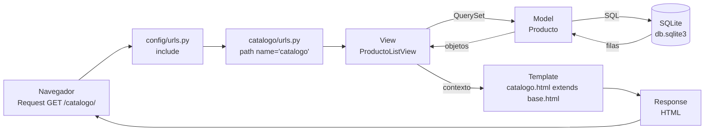

# Catálogo de Productos Tecnológicos (Django)

Aplicación web con **Django 5.2** que muestra un catálogo de productos tecnológicos, aplicando el patrón **MTV** (Model-Template-View), vistas FBV y CBV, plantillas con herencia y el ORM de Django sobre SQLite.

**Asignatura:** Desarrollo de Aplicaciones Web (IS093A) — Semana 11 (grupal)

## Integrantes y roles

-Ramos Tacza Camilda (Arquitecta Django - QA & ORM Validator)
-Torres Ambrosio Katherine Medally (Desarrolladora de Vistas - Ingeniera de Plantillas)

## Instalación

```bash
python -m venv venv
venv\Scripts\activate              # Windows
pip install -r requirements.txt
python manage.py migrate
python manage.py poblar_productos  # carga 10 productos de ejemplo
python manage.py check
python manage.py runserver
```

| URL | Vista | Nombre de ruta |
|---|---|---|
| `http://127.0.0.1:8000/` | `home` (FBV) | `home` |
| `http://127.0.0.1:8000/catalogo/` | `ProductoListView` (CBV) | `catalogo` |
| `http://127.0.0.1:8000/admin/` | Panel de administración | — |

## Estructura del proyecto

```
├── config/                  # Proyecto: settings.py, urls.py
├── catalogo/                # App
│   ├── management/commands/
│   │   └── poblar_productos.py
│   ├── migrations/
│   ├── admin.py
│   ├── models.py            # Model
│   ├── urls.py
│   └── views.py             # View
├── templates/               # Template
│   ├── base.html
│   ├── home.html
│   └── catalogo.html
├── static/css/estilos.css
├── requirements.txt
└── README.md
```


## Diagrama MTV



| Capa MTV | Equivalente MVC | En este proyecto |
|---|---|---|
| **Model** | Model | `catalogo/models.py` → clase `Producto` |
| **Template** | View | `templates/*.html` |
| **View** | Controller | `catalogo/views.py` → `home` y `ProductoListView` |

## Modelo `Producto`

| Campo | Tipo | Descripción |
|---|---|---|
| `nombre` | `CharField(100)` | Nombre del producto |
| `precio` | `DecimalField(8,2)` | Precio en soles, mayor a 0 |
| `categoria` | `CharField(50)` con choices | Laptops, Smartphones, Audio, Monitores, Accesorios, Almacenamiento |
| `stock` | `PositiveIntegerField` | Unidades disponibles (0 = agotado) |
| `creado_en` | `DateTimeField(auto_now_add)` | Fecha de registro automática |

## QuerySets utilizados

**1. Listado ordenado por precio** (en `ProductoListView.get_queryset`):

```python
Producto.objects.order_by("precio")
```

Obtiene todos los productos de menor a mayor precio.

**2. Productos con stock, filtrados por categoría** (filtros opcionales de la vista):

```python
Producto.objects.filter(categoria="Laptops").filter(stock__gt=0).order_by("precio")
```

`stock__gt=0` es un *lookup* que significa "stock mayor que 0". Los filtros se encadenan según los parámetros de la URL (`?categoria=Laptops&stock=1`).

## Lazy evaluation

Los QuerySets de Django son **perezosos**: crearlos o encadenar filtros **no consulta** la base de datos. La consulta SQL se ejecuta recién cuando se necesitan los datos (al iterar con `for`, al usar `list()`, `len()`, `count()` o al renderizar la plantilla).

Prueba en la consola (`python manage.py shell`):

```python
from django.db import connection, reset_queries
reset_queries()
qs = Producto.objects.filter(stock__gt=0).order_by("precio")
len(connection.queries)   # 0  -> todavía no se consultó la BD
print(qs.query)           # muestra el SQL que se ejecutará
list(qs)                  # aquí se ejecuta la consulta
len(connection.queries)   # 1
```

Ventaja: la vista puede construir el QuerySet paso a paso (filtro por categoría, luego por stock) y Django ejecuta **una sola consulta** con todos los filtros combinados.


## Capturas

### `/catalogo/` renderizado


### Página de bienvenida


## Validación técnica

- `python manage.py check` → `System check identified no issues (0 silenced).`
- `runserver` sin errores 404/500 en `/` y `/catalogo/`.
- Las plantillas muestran datos reales de la base de datos.

## Buenas prácticas aplicadas

- `SECRET_KEY` no está escrita en el código: se lee de la variable de entorno `DJANGO_SECRET_KEY`.
- `db.sqlite3`, `venv/`, `__pycache__/` y `.env` están en `.gitignore`.
- Las URLs de las plantillas usan ``, nunca rutas escritas a mano.
- Cada integrante trabajó en su propia rama y archivos, unidos mediante Pull Requests.
